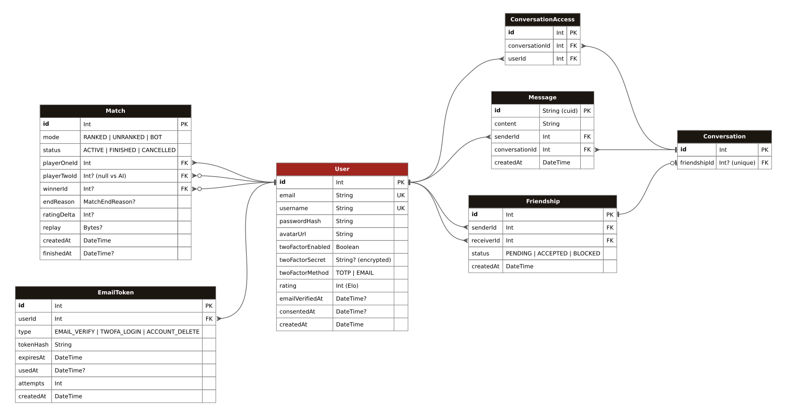

_This project has been created as part of the 42 curriculum by ehosta, mobenhab, sgil--de, mdourdoi, ticasali._

# ft_transcendence - Onitama

## Table of contents

- [Description](#description)
- [Instructions](#instructions)
- [Team Information](#team-information)
- [Project Management](#project-management)
- [Technical Stack](#technical-stack)
- [Database Schema](#database-schema)
- [Features List](#features-list)
- [Modules](#modules)
- [Individual Contributions](#individual-contributions)
- [Browser Support and Known Limitations](#browser-support-and-known-limitations)
- [Resources](#resources)

## Description

**Onitama** is a web platform for playing [Onitama](https://en.wikipedia.org/wiki/Onitama), a two-player abstract strategy game set in feudal Japan, online against other players or against an AI.

Each player controls a Master and four Students on a 5×5 board. Five move cards are dealt at the start of the game: two for each player and one neutral card. Every turn, a player moves one piece using one of their cards, then swaps that card with the neutral one. A player wins by capturing the opponent's Master (**Way of the Stone**) or by moving their own Master onto the opponent's temple (**Way of the Stream**).

The goal of the project was to build a complete, real-time and secure web application around this game, with its own visual identity inspired by Japanese ink painting.

### Key features

- **Online games** in real time between two players on separate computers, with a 10-minute clock per player, reconnection and a forfeit on long disconnections.
- **Three game modes**: **Ranked** (Elo rating and rating-based matchmaking), **Normal** (unranked matchmaking) and **Training** (against an AI with four difficulty levels).
- **Direct challenges**: invite a friend to a game from the friends list or the chat.
- **Social features**: friends, friend requests, blocking, online status, private chat, user search and public profiles.
- **Statistics and match history**: win rate, Elo progression, daily performance, most played cards, frequent opponents, full replays and a move-by-move analysis of every finished game.
- **Account security**: hashed passwords, email verification, two-factor authentication (authenticator app or email code), HTTPS only, behind a ModSecurity WAF, with all secrets stored in HashiCorp Vault.
- **Privacy**: data export, account deletion confirmed by email, and Privacy Policy and Terms of Service pages.
- **Internationalization**: English, French and Spanish, switchable at any time.

## Instructions

### Prerequisites

- [Docker Engine](https://docs.docker.com/engine/install/) with the **Docker Compose v2** plugin (`docker compose`)
- **GNU make**
- Port **8443** free on the host
- A Gmail **app password** for the project mailbox `onitama.transcendance@gmail.com`, used to send verification, 2FA and account-deletion emails
- A recent version of Google Chrome (other supported browsers are listed [below](#browser-support-and-known-limitations))

### Secrets and environment

All credentials are stored in **HashiCorp Vault**, not in a `.env` file. On first launch, the `vault-init` container initializes and unseals Vault, generates the JWT secret, the 2FA encryption key and the database password, and writes the non-secret configuration (`APP_URL`, `CORS_ORIGIN`, SMTP host, etc.) to Vault. The backend and the database each read only their own secrets, using a dedicated AppRole and policy.

The only value that must be provided by hand is the SMTP password:

1. Create the secret file with the Gmail app password (the password only, no `KEY=`):

   ```sh
   mkdir -p secrets
   printf '%s' 'your-smtp-password' > secrets/smtp_password.txt
   chmod 600 secrets/smtp_password.txt
   ```

   The `secrets/` folder is git-ignored, so you need to create it yourself.

2. Launch the stack:

   ```sh
   make
   ```

3. Open **https://localhost:8443** in your browser. The certificate is self-signed, so you have to accept the browser warning the first time.

On every `make`, `vault-init` reads this file (mounted as a Docker secret at `/run/secrets/smtp_password`) and writes its content to Vault at `secret/smtp`. The backend reads it from Vault when it starts. What happens depends on the content of the file:

| `secrets/smtp_password.txt` | Result |
| --- | --- |
| Missing | `docker compose` refuses to start the stack. |
| Empty | `vault-init` fails with `SMTP password is missing`, so the database and the backend do not start. |
| Wrong password | The stack starts, but the backend logs `SMTP unreachable: Invalid login` and no email is sent (email verification, 2FA codes by email, data export, account deletion). |
| Correct password | The backend logs `SMTP connection OK` (check with `make logs`). |

To change the password while the stack is running, edit the file, then update Vault and restart the backend so that it reads the new value:

```sh
make
docker compose restart backend
```

`make re` also applies the new password, but it deletes all the data (accounts, matches, messages, avatars).

### Makefile targets

| Command | Description |
| --- | --- |
| `make` / `make up` | Build and start the whole stack in the background |
| `make down` | Stop the stack |
| `make re` | Remove everything (containers, volumes) and rebuild from scratch |
| `make clean` | Stop the stack, remove its volumes and prune Docker |
| `make logs` | Follow the logs of all services |
| `make ps` | List the running services |
| `make migrate` | Push the Prisma schema to the database |
| `make studio` | Open Prisma Studio on `127.0.0.1:5555` |
| `make lint` | Run ESLint on the backend |
| `make test` | Run the backend unit tests |
| `make bruno` | Run the Bruno API and WebSocket test collection against the running stack |

### Services

| Service | Role |
| --- | --- |
| `waf` | Nginx + ModSecurity (OWASP CRS), TLS termination, single entry point on port 8443 |
| `frontend` | Svelte application built with Vite and served as static files by Nginx |
| `backend` | NestJS REST API and Socket.IO gateways |
| `db` | PostgreSQL 16 |
| `redis` | Game sessions, matchmaking queues, locks and the Socket.IO adapter |
| `vault` | HashiCorp Vault server (file storage) |
| `vault-init` | One-shot container that initializes, unseals and provisions Vault |

## Team Information

| Member | Login | Role(s) | Responsibilities |
| --- | --- | --- | --- |
| Timothée | `ticasali` | **Product Owner**, Developer (frontend) | Defined the product vision and the visual identity. Wrote the 75-page art direction document that served as the guideline for the whole interface, designed the complete mockup of the application, and built the frontend skeleton. Validated that completed work matched the expected result. |
| Matthieu | `mdourdoi` | **Project Manager**, Developer (backend, DevOps) | Managed the GitHub issues, wrote the pull request template, organized the repository and planned the weekly meetings. Tracked progress and blockers. Implemented the authentication backend (registration, login, JWT), the real-time WebSocket layer (presence, chat, friendship events), the users module, the TOTP 2FA, the avatar upload and the security infrastructure (HTTPS, WAF, Vault). |
| Swann | `sgil--de` | **Technical Lead / Architect**, Developer (game, AI) | Chose the technologies, wrote the initial boilerplates and the project's architecture, and connected the frontend and the backend. Built the game, the matchmaking and the AI, and turned the frontend into a library of reusable components. Reviewed pull requests from both teams. |
| Hicham | `mobenhab` | Developer (frontend) | Built the first versions of the login, home, history and game pages, then connected the frontend to the API and to the WebSockets: authentication, friends, profile, chat and statistics. |
| Elouann | `ehosta` | Developer (backend, DevOps) | Implemented the friendship system (with the conversation of each friendship), the email service and every email-based flow (verification, email 2FA, data export, account deletion), the end-to-end API tests, and reorganized the frontend components. |

## Project Management

### Work organization

- The team was split into two sub-teams: **frontend** (Hicham, Timothée) and **backend / DevOps** (Elouann, Matthieu). Swann worked on the game and the AI and acted as the link between the two teams.
- Every **week**, the whole team met to review what had been done, discuss the progress and blockers, and plan the next tasks.
- Work was broken down into GitHub issues, each one assigned to a member and handled in its own branch (`feat/...`, `fix/...`, `devops/...`).

### Code reviews

Every change went through a **pull request** based on a shared template. Each sub-team reviewed the pull requests of its own domain, and the Technical Lead reviewed pull requests from both teams. We first wanted every pull request to get one frontend and one backend review, whatever its domain, but this proved too slow in practice, so we switched to reviews per team.

### Tools

| Purpose | Tool |
| --- | --- |
| Task tracking | GitHub Issues |
| Code review | GitHub Pull Requests, with a PR template |
| Communication | Discord |
| Meetings | Weekly progress and planning meeting |
| API testing | Bruno (collection in `bruno/`) |

## Technical Stack

### Frontend

- **Svelte 5** (runes) with **TypeScript**, bundled by **Vite**. Svelte compiles components to small, fast JavaScript with very little boilerplate, which made it easier to learn for the members who did not know the stack.
- **Tailwind CSS 4** for styling, with theme tokens defined in `app.css`.
- **shadcn-svelte / bits-ui** as accessible low-level primitives (dialogs, tabs, tooltips...), on top of which our own Onitama components are built.
- **svelte-i18n** for translations, **layerchart** for statistics charts, **socket.io-client** for real time, **motion** and **embla-carousel** for animations and carousels.
- **Vitest** and Testing Library for frontend tests.

### Backend

- **NestJS** with **TypeScript**. Its modules, dependency injection, guards, validation pipes and built-in WebSocket gateways gave the project a clear structure, and TypeScript on both sides let us use the same language and the same game model in the frontend and the backend.
- **Socket.IO** for real-time communication, with the **Redis adapter**.
- **Prisma 7** as the ORM, with the PostgreSQL driver adapter.
- **class-validator / class-transformer** to validate every request body and WebSocket payload.
- **bcrypt** (password hashing), **JWT** (authentication), **otplib** + **qrcode** (TOTP 2FA), **nodemailer** (emails), **multer** + **file-type** (avatar upload with content checks).
- **Node.js worker threads** to run the AI search without blocking the event loop.

### Database

- **PostgreSQL 16**: our data is strongly relational (users, friendships, conversations, matches) and needs constraints, cascades and transactions. For example, a finished ranked match and the rating update of both players are written in a single transaction.
- **Redis 7**: in-memory store for live game sessions, game deadlines (clocks, disconnections), matchmaking queues (a list for normal games, a sorted set by rating for ranked games), distributed locks against race conditions, and the Socket.IO adapter.

### Security and infrastructure

- **Docker Compose**: the whole stack starts with a single `make`.
- **Nginx + ModSecurity v3 + OWASP Core Rule Set**: single HTTPS entry point (TLS 1.2/1.3), security headers, and a WAF in blocking mode with targeted exclusions only.
- **HashiCorp Vault**: KV v2 secret engine, AppRole authentication and least-privilege policies for the backend and the database.

## Database Schema



Each arrow goes from a foreign key to the primary key it references. A crow's foot marks the "many" side, a bar the "one" side, and a circle an optional (nullable) foreign key.

| Table | Description |
| --- | --- |
| `User` | Account, credentials (bcrypt hash), avatar, 2FA settings (encrypted secret), Elo rating, email verification and terms consent dates. |
| `Friendship` | Relation between two users with a status: `PENDING`, `ACCEPTED` or `BLOCKED`. The `(senderId, receiverId)` pair is unique. |
| `Conversation` | Private conversation, linked one-to-one to an accepted friendship. |
| `ConversationAccess` | Which users may read and write in a conversation (unique `(conversationId, userId)`). |
| `Message` | A chat message, indexed by `(conversationId, createdAt)` for cursor pagination. |
| `Match` | A game: mode (`RANKED`, `UNRANKED`, `BOT`), status (`ACTIVE`, `FINISHED`, `CANCELLED`), players, winner, end reason (`WAY_OF_STONE`, `WAY_OF_STREAM`, `RESIGNATION`, `DISCONNECTION`, `TIMEOUT`), rating change and a compact binary replay. |
| `EmailToken` | Single-use hashed tokens for email verification, email 2FA codes and account deletion, with an expiry date and an attempt counter. |

Deleting a user cascades to their friendships, conversations, messages, matches and tokens. The schema is split into `backend/prisma/main.prisma`, `user.prisma` and `queue.prisma`.

## Features List

| Feature | Description | Member(s) |
| --- | --- | --- |
| Art direction and mockup | 75-page art direction document (visual identity, colors, typography, layout of every screen) and a complete mockup of the application | ticasali |
| Frontend skeleton and assets | First coded versions of the home, friends, history, profile and statistics pages, the navigation bar and the game page styling; client-side game engine and move cards; integration of the game assets (cards, pieces, avatars, backgrounds, icons) | ticasali |
| Project architecture | Monorepo, NestJS and Svelte boilerplates, Docker setup, router, i18n setup, Prisma setup | sgil--de |
| Registration and login | Email and password sign-up, bcrypt hashing and JWT sessions (backend, mdourdoi); login and registration page with error messages and the 2FA step (frontend, mobenhab) | mdourdoi, mobenhab |
| Email service | Gmail SMTP emails for verification links, 2FA codes, data export and account deletion | ehosta |
| Email verification | Verification link sent by email, single-use hashed token | ehosta |
| Two-factor authentication | TOTP with a QR code for an authenticator app (mdourdoi) or code by email (ehosta); required to log in, to change the password and to disable 2FA | mdourdoi, ehosta |
| User profile | Edit username, change password and upload an avatar (backend); profile pages and their connection to the API (frontend) | mdourdoi, mobenhab, sgil--de |
| Friends system | Send, cancel, accept and deny friend requests; remove and block or unblock users (backend, ehosta); friend requests by username (sgil--de); real-time friendship events over WebSockets (mdourdoi); friends interface (mobenhab, sgil--de) | ehosta, sgil--de, mdourdoi, mobenhab |
| Online status | Friends' presence updated live over WebSockets | mdourdoi |
| User search | Search players by username and open their profile; lookup of a user by exact username for the social routes | sgil--de, ehosta |
| Private chat | One conversation per friendship (ehosta), messages API with cursor pagination (sgil--de), real-time delivery over WebSockets (mdourdoi), chat client (mobenhab) and chat interface (sgil--de) | ehosta, sgil--de, mdourdoi, mobenhab |
| Game invitations | Challenge a friend from the friends list or the chat; invitations expire after 60 seconds | sgil--de |
| Onitama game engine | Complete rules, move validation on the server, clocks, both victory conditions, resignation | sgil--de |
| Game interface | First game page (mobenhab), game page styling and assets (ticasali), board, cards, player panels, move highlighting and end-of-game dialogs (sgil--de) | sgil--de, ticasali, mobenhab |
| Matchmaking | Normal queue (first in, first out) and ranked queue (rating range widening over time) | sgil--de |
| Ranked mode | Elo rating (K = 32) updated in the same transaction as the match result | sgil--de |
| Remote play and reconnection | Game state stored in Redis, restored on reconnection; forfeit after 30 seconds of disconnection | sgil--de |
| AI opponent | Four levels (Deshi, Senpai, Sensei, Shihan) from depth-1 to depth-8 alpha-beta search, with a human-like choice of moves (sgil--de); search moved to a pool of worker threads (mdourdoi) | sgil--de, mdourdoi |
| Match history | Paginated list of games with date, mode, opponent, result and end reason | sgil--de, mobenhab |
| Replays and analysis | Step-by-step replay of every finished game, with the advantage of each player after every move | sgil--de |
| Statistics dashboard | Games, wins, losses, win rate, breakdown by mode, Elo progression, daily performance, most played cards, frequent opponents | mobenhab, sgil--de |
| Internationalization | English, French and Spanish, language switcher on every page | sgil--de |
| GDPR tools | Privacy Policy and Terms of Service pages, consent at registration (sgil--de); JSON export of all personal data and account deletion confirmed by email (ehosta) | sgil--de, ehosta |
| HTTPS and WAF | Nginx reverse proxy with TLS, ModSecurity and OWASP CRS | mdourdoi |
| Secrets management | All secrets in Vault, AppRole authentication per service | mdourdoi |
| Page transitions and animations | Animated navigation between pages | sgil--de |
| Tests | Backend unit tests (game, AI, services) and a Bruno collection for the API and WebSockets (sgil--de); end-to-end API tests (ehosta) | sgil--de, ehosta |

## Modules

### Point calculation

| # | Module | Category | Type | Points |
| --- | --- | --- | --- | --- |
| 1 | Use a framework for both the frontend and the backend | Web | Major | 2 |
| 2 | Real-time features using WebSockets | Web | Major | 2 |
| 3 | Allow users to interact with other users | Web | Major | 2 |
| 4 | Use an ORM for the database | Web | Minor | 1 |
| 5 | Custom-made design system | Web | Minor | 1 |
| 6 | Support for multiple languages | Accessibility | Minor | 1 |
| 7 | Support for additional browsers | Accessibility | Minor | 1 |
| 8 | Standard user management and authentication | User Management | Major | 2 |
| 9 | Game statistics and match history | User Management | Minor | 1 |
| 10 | Two-Factor Authentication (2FA) | User Management | Minor | 1 |
| 11 | AI opponent | Artificial Intelligence | Major | 2 |
| 12 | WAF/ModSecurity (hardened) + HashiCorp Vault | Cybersecurity | Major | 2 |
| 13 | Complete web-based game | Gaming | Major | 2 |
| 14 | Remote players | Gaming | Major | 2 |
| 15 | GDPR compliance | Data and Analytics | Minor | 1 |
| | **Total** | | **9 Major + 6 Minor** | **23** |

### 1. Frameworks for frontend and backend (Major, 2 pts)

- **Why**: a structured framework on each side was the best way to keep a five-person codebase consistent.
- **How**: the frontend uses **Svelte 5** (components, runes, a small custom router, stores). The backend uses **NestJS** (one module per domain: auth, users, friendships, messages, game, queue, matches, bots, mail, twofa; guards, DTO validation pipes and WebSocket gateways).
- **Who**: sgil--de (boilerplates and architecture), the whole team.

### 2. Real-time features with WebSockets (Major, 2 pts)

- **Why**: online games, chat, presence and invitations must be instant.
- **How**: three Socket.IO namespaces: `/` (presence, chat, friendship events, game invitations), `/queue` (matchmaking) and `/game` (game actions and state). Every connection is authenticated with the JWT, and tokens are renewed live before they expire. Each user joins a private `user:<id>` room and each game a `match:<id>` room, so events are only broadcast to the people concerned. Disconnections are handled: presence goes offline when the last socket closes, and a game warns the opponent and starts a forfeit timer. The Redis adapter keeps broadcasts consistent across instances.
- **Who**: mdourdoi (WebSocket foundation, presence, chat and friendship events), sgil--de (game and queue gateways), mobenhab (frontend socket client).

### 3. User interaction (Major, 2 pts)

- **Why**: a game platform needs a social layer to find, follow and talk to other players.
- **How**:
  - **Chat**: private conversations between friends, real-time messages and paginated history.
  - **Profiles**: public profile pages with avatar, rating and statistics.
  - **Friends**: requests, accept, deny, cancel, remove and block, with a live friends list and online status.
- **Who**: ehosta (friendship system and conversations), mdourdoi (real-time chat and events), sgil--de (messages API, user search, chat interface), mobenhab (profile, friends and chat connected to the backend).

### 4. ORM (Minor, 1 pt)

- **Why**: type-safe database access and a single source of truth for the schema.
- **How**: **Prisma 7** with a multi-file schema, generated TypeScript client, relations with cascades, indexes and interactive transactions (for example for the match result and the rating update).
- **Who**: sgil--de, ehosta.

### 5. Custom-made design system (Minor, 1 pt)

- **Why**: the art direction document defined a strong visual identity, inspired by Japanese ink painting, which had to stay consistent on every screen.
- **How**:
  - **Color palette**: ink and paper tones (`#a22520` red, `#1c1611` ink, `#efe0c4` paper...) defined as design tokens in `app.css`, with a dark theme and matching chart colors.
  - **Typography**: the *Kaushan Script* brush font, exposed as the `font-display` and `font-brush` tokens.
  - **Icons**: custom icon sets (52 interface icons in `assets/icons`, plus brush strokes, frames, card and board graphics in `assets/game`).
  - **Reusable components**: 43 Onitama components organized by domain (`onitama/`, `auth/`, `game/`, `profile/`, `friends/`, `history/`, `players/`), each exported through an `index.ts`. Among them: `PageShell`, `PageHeader`, `StandalonePage`, `SideNav`, `InkQuote`, `Stamp`, `PlayButton`, `AuthForm`, `AuthField`, `AuthButton`, `MoveCard`, `Cell`, `HistoryTable`, `IdentityCard` and `StatsPanel`, reused across the application.
- **Who**: ticasali (art direction, mockup, assets), sgil--de (component library), ehosta (component organization).

### 6. Multiple languages (Minor, 1 pt)

- **Why**: make the platform accessible to more players.
- **How**: **svelte-i18n** with three complete translations (`en.json`, `fr.json` and `es.json`, the same 408 keys each). Tests check that the locale files have the same keys and no empty translation. The initial language comes from the browser, and a language switcher is always visible in the top-right corner. Every user-facing text, including backend error codes, is translated.
- **Who**: sgil--de.

### 7. Additional browsers (Minor, 1 pt)

- **Why**: players do not all use Chrome.
- **How**: every feature was tested on **Firefox**, **Zen** and **Brave** in addition to Google Chrome, covering both the Gecko and Chromium engines. See [Browser Support](#browser-support-and-known-limitations).
- **Who**: the whole team.

### 8. Standard user management and authentication (Major, 2 pts)

- **Why**: users need a real account to keep their rating, friends and history.
- **How**: users can update their username and password, and upload an avatar (PNG, JPEG or WebP, 2 MB max, type checked in the browser and on the server from the file content). A default avatar is used when none is uploaded. Users can add friends and see their online status, and each user has a profile page with their information and statistics.
- **Who**: mdourdoi (users module: profile update, avatar upload, password change; online status), ehosta (friends), mobenhab (profile pages connected to the API), sgil--de (profile interface).

### 9. Game statistics and match history (Minor, 1 pt)

- **Why**: players want to see their progression and learn from their games.
- **How**:
  - **Statistics**: games played, wins, losses, win rate, breakdown by game mode, Elo rating, most played cards and most frequent opponents.
  - **Achievements and progression**: what the player achieved is shown day by day, with the daily win rate and the best day over the last week, and the evolution of their Elo rating month after month.
  - **Match history**: every game with its date, mode, opponent, result and end reason, a step-by-step replay, and an analysis of the advantage of each player after every move.
- **Who**: sgil--de (matches API, history, replays, analysis), mobenhab (statistics dashboard).

### 10. Two-Factor Authentication (Minor, 1 pt)

- **Why**: protect accounts beyond the password.
- **How**: two methods: **TOTP** (QR code for an authenticator app; the secret is stored encrypted with a key from Vault) or a **one-time code sent by email**. When 2FA is enabled, a code is required to log in, to change the password and to disable 2FA. Email codes are hashed, expire, and have a limited number of attempts.
- **Who**: mdourdoi (TOTP), ehosta (email codes).

### 11. AI opponent (Major, 2 pts)

- **Why**: let players train at their own level, at any time.
- **How**: the AI uses a **minimax search with alpha-beta pruning** on the same game engine as the server, with a heuristic evaluation (material, threats on the Master and the temple, unprotected pieces, board control, distance to the temple, mobility). To play like a human rather than perfectly, it does not always pick the best move: it picks a move at random among the good ones (softmax), with a "temperature" that controls how often it makes mistakes. The four levels combine search depth and temperature, from Deshi (depth 1, many mistakes) to Shihan (depth 8, no randomness). The search runs in a pool of worker threads so that it never blocks the server. The AI plays under the same rules as a human player and can win.
- **Who**: sgil--de (AI), mdourdoi (worker thread pool).

### 12. WAF/ModSecurity (hardened) + HashiCorp Vault (Major, 2 pts)

- **Why**: protect the application from common web attacks and keep secrets out of the repository and images.
- **How**:
  - **WAF**: Nginx with ModSecurity v3 and the **OWASP Core Rule Set** in blocking mode (`SecRuleEngine On`), restricted HTTP methods, and only targeted exclusions (password fields, Socket.IO transport). The exclusions in `waf/conf/modsec/exclusions.conf` are adapted from the examples shipped with the CRS: the password exclusions follow the `ctl:ruleRemoveTargetByTag=OWASP_CRS` example of `REQUEST-900-EXCLUSION-RULES-BEFORE-CRS.conf.example`, and the allowed methods and content types follow rules 900200 and 900220 of `crs-setup.conf.example`. It is also the only HTTPS entry point, with TLS 1.2/1.3 and security headers.
  - **Vault**: runs as a real server (not dev mode) with persistent file storage. `vault-init` initializes and unseals it, generates the secrets, and provisions **AppRole** credentials with least-privilege policies for the backend and the database, with short-lived tokens. No secret is stored in a file in the repository.
- **Who**: mdourdoi.

### 13. Complete web-based game (Major, 2 pts)

- **Why**: Onitama is easy to learn, deep to master, and well suited to a turn-based online game.
- **How**: the full rules are implemented in a game engine on the backend, mirrored in the frontend for move highlighting, and the server is authoritative (it validates every move). Each player has a 10-minute clock. A game ends by Way of the Stone, Way of the Stream, resignation, timeout or disconnection. The interface highlights the legal moves for the selected card and piece.
- **Who**: sgil--de (engine and interface), ticasali (art direction, client-side engine, assets), mobenhab (first game page).

### 14. Remote players (Major, 2 pts)

- **Why**: the main use of the platform is playing against other people on their own computers.
- **How**: players are matched through the normal or ranked queue (or a direct invitation), and the game state lives in Redis with distributed locks against concurrent actions. When a player disconnects, the opponent is notified and a 30-second countdown starts. Reloading the page or reconnecting restores the full game state, and the lobby offers to resume an ongoing game. If the player does not come back, they lose by forfeit, and games where a player never joins are cancelled.
- **Who**: sgil--de.

### 15. GDPR compliance (Minor, 1 pt)

- **Why**: users must stay in control of their personal data.
- **How**: from the privacy page, users can download all their data (account, friendships, messages, matches) as a readable JSON file, and an email confirms the export. Deleting the account requires a confirmation link sent by email; the deletion then removes all related data and disconnects every session of the user. Consent to the Privacy Policy and the Terms of Service is required, and recorded, at registration.
- **Who**: sgil--de (privacy pages, consent), ehosta (data export, account deletion, emails).

## Individual Contributions

### ticasali (Timothée) - Product Owner, frontend

- Wrote the **75-page art direction document**, the reference for the whole interface: visual identity, color palette, typography, mood, and the expected rendering of every screen. The visual identity of the application comes from it.
- Designed the **complete mockup** of the application before development started, so that the frontend team knew exactly what to build.
- Built the **frontend skeleton**: first coded versions of the home, friends, history, profile and statistics pages, the navigation bar and the game page styling.
- Wrote the first **client-side game engine** and the **move cards** of the game page.
- Gathered, prepared and integrated the **graphic assets** of the game (cards, pieces, avatars, backgrounds, decor and icons).
- As Product Owner, defined the features and their priorities, and checked that completed work matched the product vision.
- **Challenges**: he discovered the frontend stack during the project. With no artist on the team, he had to give the application a strong visual identity on his own, which is why so much of his work went into the art direction and the assets rather than into code.

### mdourdoi (Matthieu) - Project Manager, backend and DevOps

- Organized the project: GitHub issues, pull request template, repository organization and weekly meetings.
- **Authentication**: registration, login and JWT sessions.
- **WebSockets**: foundation of the real-time gateway, online presence, real-time chat messages and friendship events.
- **Users**: the users module (`users/me`, profile update, avatar upload, password change, public profiles).
- **2FA**: TOTP setup and verification, 2FA required on sensitive actions.
- **AI**: moved the AI search to a pool of worker threads so that it never blocks the server.
- **DevOps and security**: HTTPS reverse proxy, ModSecurity WAF with the OWASP CRS, migration of every secret to Vault with AppRole authentication.
- **Challenges**: he did not know NestJS or the rest of the stack at the beginning, and had to get up to speed quickly with the help of sgil--de and ehosta. Making ModSecurity strict without breaking the application required fine-tuned exclusions.

### sgil--de (Swann) - Technical Lead, game and AI

- Chose the stack, wrote the initial boilerplates (NestJS, Svelte, Docker, Prisma, router, i18n) and set up the architecture of the project.
- **Backend foundations**.
- **Game**: Onitama engine, gameplay, game WebSocket gateway, clocks, reconnection and forfeits.
- **Matchmaking**: normal and ranked queues, Elo rating, matches API, history, replays and analysis.
- **AI**: alpha-beta search, evaluation and difficulty levels.
- **Frontend**: refactor into a library of reusable Onitama components, game interface, chat and friends interface, user search, page animations, full translation and Spanish locale.
- Game invitations, privacy pages and consent, unit tests and the Bruno collection.
- Reviewed pull requests of both teams and acted as the link between the frontend and the backend.
- **Challenges**: he had to teach the stack to the rest of the team while avoiding doing the work in their place, so that the workload stayed balanced. Keeping the game state consistent under concurrent actions and disconnections required Redis locks and deadline handling.

### mobenhab (Hicham) - frontend

- **First versions of the pages**: login and registration page (with error messages and the 2FA step), home page structure, history tab and game page foundation.
- **Frontend and backend link**: authentication client, Socket.IO client (presence, friendship events, chat messages), and the friends and profile stores.
- **Profile and friends features** connected to the API.
- **Statistics dashboard** connected to the match data.
- **Challenges**: he discovered Svelte and TypeScript during the project and had to adapt quickly to connect many pages to an API and to WebSocket events that were evolving at the same time.

### ehosta (Elouann) - backend and DevOps

- **Friendships**: the whole friendship system (requests, accept, deny, cancel, remove, block and unblock), with the private conversation created for each friendship.
- **Email service** with Gmail SMTP, and every flow that relies on it: email verification, 2FA codes by email, data export and account deletion confirmed by email.
- Lookup of a user by username, used by the social routes.
- **End-to-end tests** of the API.
- Reorganization of the frontend components.
- **Challenges**: like sgil--de, he already knew the stack and had to help the others learn it, while making sure the work stayed fairly distributed.

## Browser Support and Known Limitations

| Browser | Engine | Status |
| --- | --- | --- |
| Google Chrome (latest stable) | Chromium | Supported (reference browser) |
| Mozilla Firefox | Gecko | Supported, all features tested |
| Zen | Gecko | Supported, all features tested |
| Brave | Chromium | Supported, all features tested |

No browser-specific limitation was found: every feature (authentication, game, chat, statistics, uploads, language switching) behaves the same and has the same interface in all the browsers above.

General limitations:

- The TLS certificate is **self-signed**, so browsers show a warning on the first visit.
- Emails are sent through a Gmail account: the SMTP app password must be provided in `secrets/smtp_password.txt` (see [Instructions](#instructions)).

## Resources

### References

- [Online Onitama](https://onitama.app/#/)
- [Rules Onitama](http://jeuxstrategie1.free.fr/jeu_onitama/regle.pdf)
- [Alpha-Beta](https://www.geeksforgeeks.org/artificial-intelligence/alpha-beta-pruning-in-adversarial-search-algorithms/)
- [Svelte documentation](https://svelte.dev/docs)
- [NestJS documentation](https://docs.nestjs.com/)
- [Prisma documentation](https://www.prisma.io/docs)
- [Socket.IO documentation](https://socket.io/docs/v4/)
- [OWASP ModSecurity Core Rule Set](https://coreruleset.org/docs/)
- [CRS v3.3 - REQUEST-900-EXCLUSION-RULES-BEFORE-CRS.conf.example](https://github.com/SpiderLabs/owasp-modsecurity-crs/blob/v3.3/dev/rules/REQUEST-900-EXCLUSION-RULES-BEFORE-CRS.conf.example) (base of our rule exclusions)
- [CRS v3.3 - crs-setup.conf.example](https://github.com/coreruleset/coreruleset/blob/v3.3/master/crs-setup.conf.example) (rules 900200 and 900220, allowed methods and content types)
- [HashiCorp Vault - AppRole auth method](https://developer.hashicorp.com/vault/docs/auth/approle)
- [Elo rating system](https://en.wikipedia.org/wiki/Elo_rating_system)
- [RFC 6238 - TOTP](https://datatracker.ietf.org/doc/html/rfc6238)

### Use of AI

AI was used as a **learning aid**, not to generate the project:

- **Getting started with an unknown stack or concept**: members who did not know a technology used AI to be guided through it, then wrote the code on their own. For example, mdourdoi, who did not know NestJS, used it to understand how to structure the `users/me` routes, which cover many cases (profile, avatar, password, 2FA), and the team used it to get examples of WebSocket patterns before implementing its own gateways.
- **Code review**: AI was used as an additional reviewer on pull requests, **in addition to** the human reviews, never instead of them
- **Assets creation**: We created the assets with ChatGPT